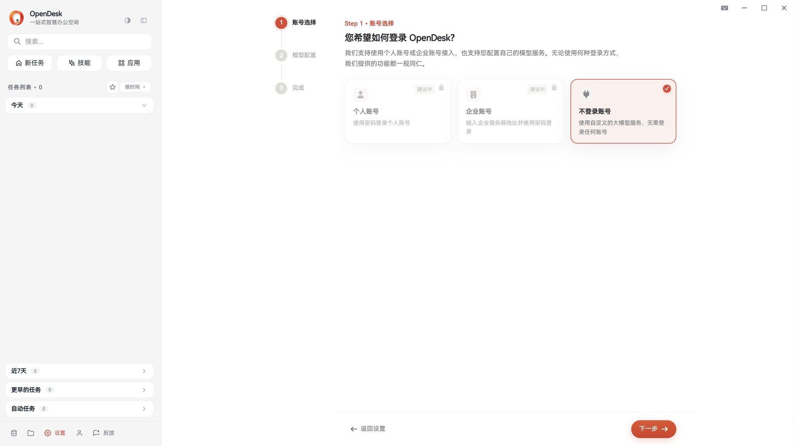
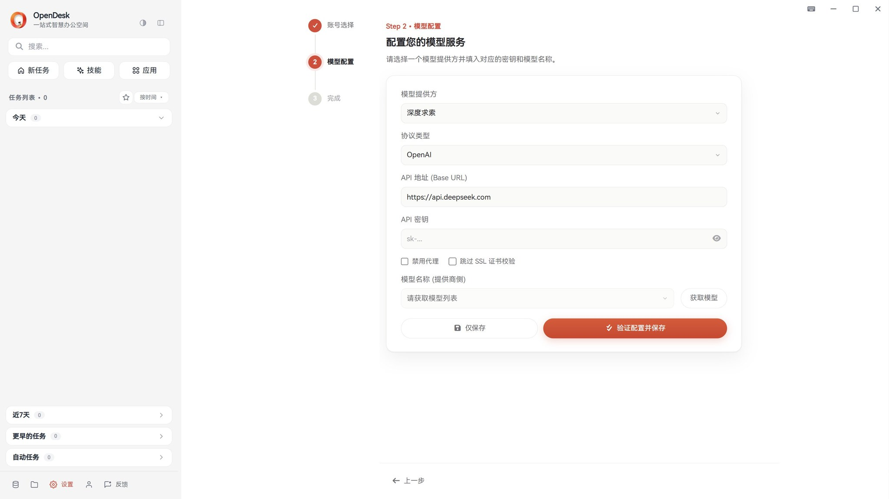
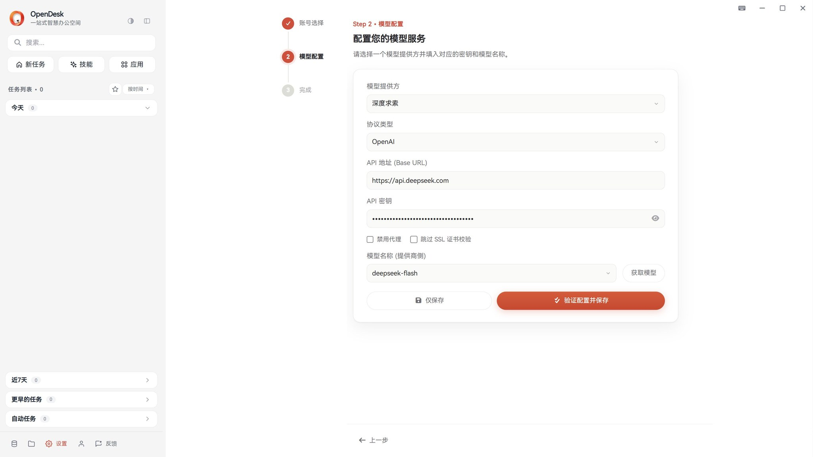
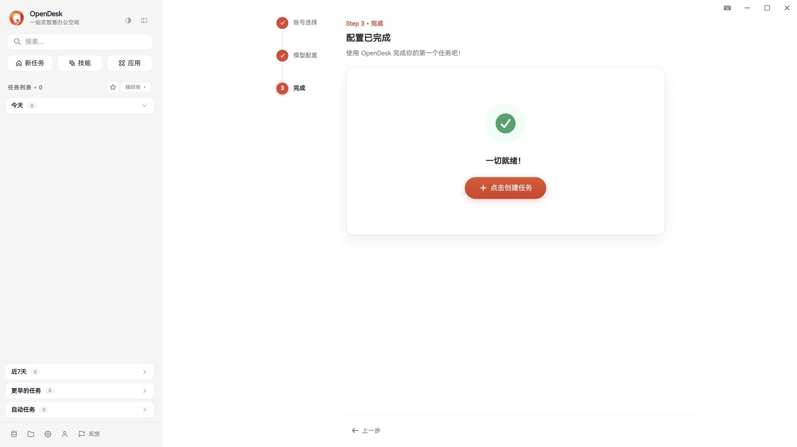
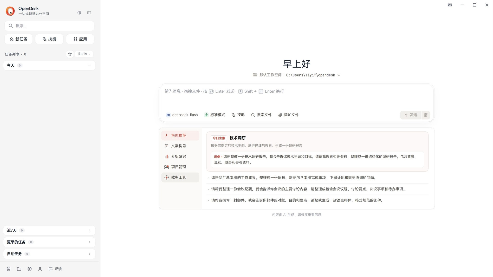
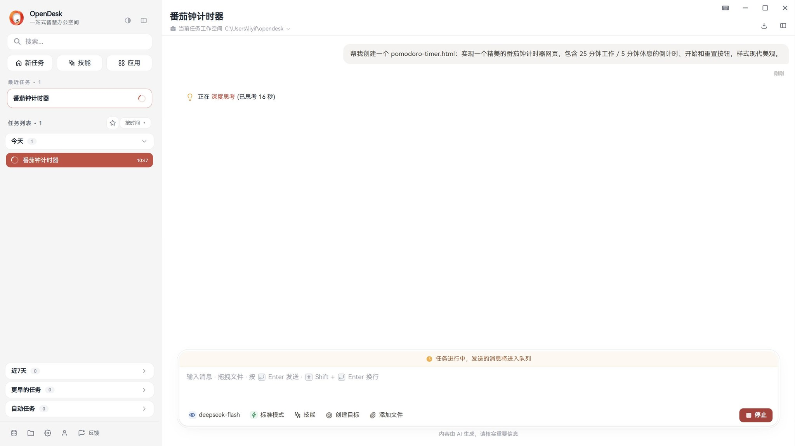
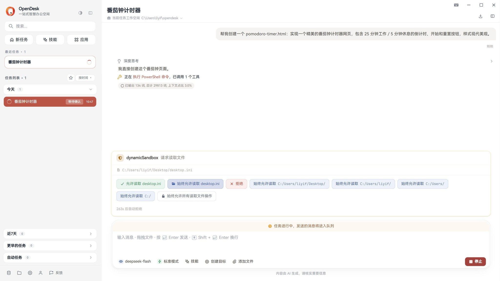
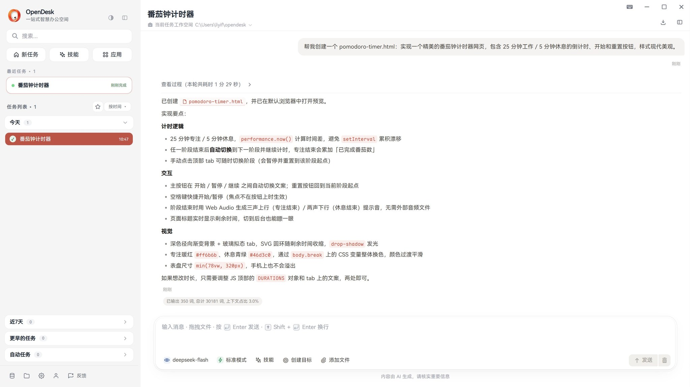
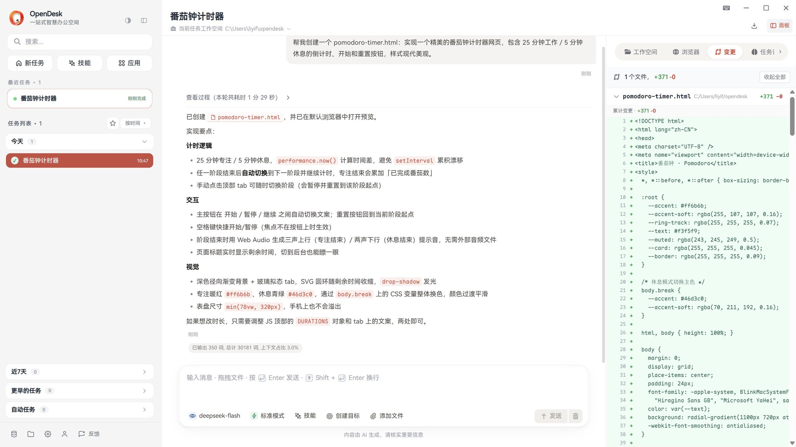
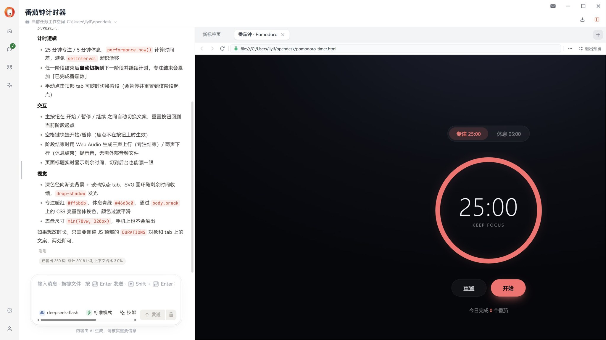

import quickstartTask from '../../../../assets/images/manual/quickstart_task.webm';

## 1. 安装 OpenDesk Desktop

OpenDesk Desktop 提供图形化界面，无需安装 NodeJS 等运行环境。

### 1.1 下载安装包

从 [下载页](/download/) 获取对应平台的最新安装包。

### 1.2 首次启动

安装完成后点击 OpenDesk 图标启动应用。首次启动会进入三步配置向导：**账号选择 → 模型配置 → 完成**，全程约 1 分钟。

---

## 2. 完成首次配置

### 2.1 选择登录方式

向导第一步选择接入方式。目前推荐**「不登录账号」**——直接使用你自己的大模型服务，无需注册，所有功能一视同仁：

选中后点击右下角「下一步」。

### 2.2 配置模型服务

OpenDesk 内置了常见服务商的预设，从下拉框选择即可（DeepSeek、OpenAI、智谱、Kimi、硅基流动、火山引擎、Ollama 等）。选择后协议类型和 API 地址会自动带出，通常不需要手动修改：

接下来只需三步：

1. **填入 API 密钥** — 在服务商控制台创建后复制过来（输入框内容默认掩码显示）；
2. **点击「获取模型」** — OpenDesk 会用你的密钥拉取可用模型列表；
3. **从下拉框选择模型** — 再点击「验证配置并保存」，OpenDesk 会真实调用一次模型 API，验证通过后自动进入下一步。

使用 OpenAI 兼容的中转 / 本地模型？

- 模型提供方选择 **「自定义」**，协议类型保持 **OpenAI**；
- 手动填写 API 地址（如 `https://your-proxy.com/v1`、Ollama 的 `http://localhost:11434/v1`）；
- 密钥没有可以随意填一个非空字符串，部分本地服务不校验。

### 2.3 完成

看到「一切就绪」即配置成功，点击「点击创建任务」直接进入主界面：

---

## 3. 认识主界面

| 区域 | 说明 |
|------|------|
| **侧边栏**（左） | 新任务、技能、应用入口，以及任务列表（按时间分组） |
| **对话区**（中） | 核心交互区，任务对话、执行过程、结果都在这里展示 |
| **输入框** | 发送消息，`Enter` 发送、`Shift + Enter` 换行 |
| **输入框下方工具栏** | 切换模型、任务模式（标准/自主等）、技能，以及搜索文件、添加文件 |
| **工作空间**（输入框上方） | 当前任务读写文件的根目录，默认为 `C:\Users\<你>\opendesk`，点击即可修改 |

OpenDesk 默认只在**当前工作空间**内读写文件，执行工作空间外的敏感操作前会先请求你的授权。

---

## 4. 创建你的第一个任务

用一句话描述需求即可，例如：

- 「帮我创建一个番茄钟计时器网页，25 分钟工作 / 5 分钟休息，样式现代美观」
- 「查看我今天的日程安排」
- 「读一下这个项目的代码，帮我理清架构」

按下 `Enter` 发送后，OpenDesk 会先创建目标、再逐步执行。执行过程中可以看到模型的思考与工具调用状态，任务进行时继续输入的消息会进入队列依次处理：

### 权限确认

当任务需要执行敏感操作（如读取工作空间外的文件、执行命令）时，OpenDesk 会弹出确认卡片，说明具体要访问的路径，并提供单次允许、始终允许、拒绝等选项，超时未处理会自动拒绝：

不相关或不想放行的请求直接点「拒绝」，任务会自行调整方案继续。

### 查看结果

任务完成后，回复中会总结完成情况。生成的文件会自动在默认浏览器打开预览：

---

## 5. 结果面板：产物、变更一目了然

点击对话区右上角「面板」按钮，展开结果面板，包含 **工作空间 / 浏览器 / 变更 / 任务** 四个视图：

- **工作空间** — 浏览任务生成和修改的文件，点击即可预览（HTML、Markdown、图片等直接渲染）；
- **浏览器** — 内置浏览器标签页，可直接与生成的网页交互；
- **变更** — 本次任务的文件变更，diff 高亮对比每处改动；
- **任务** — 任务元信息与过程记录。

变更视图示例（本次任务新增 1 个文件，+371 行）：

在「工作空间」中点击生成的 `pomodoro-timer.html`，内置浏览器会直接渲染页面，可以直接点「开始」体验：

---

## 6. 追问与迭代

任务完成后直接在输入框继续说需求即可，无需重复背景：

- 「把专注时长改成 45 分钟」
- 「再加一个饼图展示占比」
- 「导出为 PDF」

OpenDesk 会基于当前任务的上下文继续修改。对结果不满意时，也可以点击回复下方的「重新生成」，或用「编辑」修改原始需求后重新执行。

<video src={quickstartTask} autoplay loop muted playsinline />

---

## 进一步了解

| 主题 | 说明 |
|------|------|
| [Desktop 使用手册](/docs/manual/desktop/) | 完整的 Desktop 功能介绍 |
| [功能指南](/docs/manual/desktop/tools/) | 各项能力详细说明 |
| [技能系统](/docs/manual/desktop/skills/) | 邮件、日程、笔记等扩展能力 |
| [使用案例](/docs/manual/desktop/use-cases/) | 真实场景示例 |
| [常见问题](/docs/manual/desktop/faq/) | 疑问解答 |
| [CLI 快速开始](/docs/quickstart/cli/) | CLI 版安装和使用指南 |
